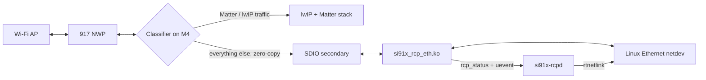

# SiWx917 Wi-Fi RCP: sharing the Matter Wi-Fi link with a Linux host over SDIO

This feature lets a SiWx917 SoC running the Matter Wi-Fi lighting app forward non-Matter Wi-Fi traffic to a Linux host (Raspberry Pi + Si-EB8045B HAT) over SDIO.
The host sees the 917 as a plain Ethernet interface. It shares the 917's MAC, IPv4 address and IPv6 addresses.
Wi-Fi connectivity is owned by the Matter commissioning process; the host has no control over it.

> Status: not validated on hardware. See [Assumptions](#assumptions-to-validate).

## Architecture



### Firmware (SiWx917 M4)

| File | Role |
|------|------|
| [wifi_rcp.c](wifi_rcp.c) | Intercepts NWP RX frames (`-Wl,--wrap=sli_si91x_wifi_data_packet_handler`), runs the SDIO task, forwards host frames to Wi-Fi, publishes link status. |
| [wifi_rcp_classifier.c](wifi_rcp_classifier.c) | Decides whether each Wi-Fi frame goes to the M4, the host, or both. Rejects host frames using M4-owned source ports. |
| [wifi_rcp_protocol.h](wifi_rcp_protocol.h) | Wire format shared with the Linux driver. |
| [wifi_rcp_config.h](wifi_rcp_config.h) | Ports, queue depth, zero-copy switch, buffer sizes. |
| [matter_wifi_rcp_lighting_app_freertos.slcp](../../../../../../slc/apps/lighting_app/wifi/matter_wifi_rcp_lighting_app_freertos.slcp) | SLC project: lighting app + `sl_sdio_secondary` + linker wrap + `wifi_rcp_init` at `service_init`. |

How traffic is split:

| Traffic | Destination |
|---------|-------------|
| UDP 5540/5550, TCP 5540, DHCP client (68), ports >= 49152 | M4 |
| ARP requests, ICMP echo requests, ICMPv6 echo/RS/NS | M4 |
| mDNS, ARP replies, other ICMP/ICMPv6, IPv4 fragments, unknown protocols | Both |
| Any other UDP/TCP port | Host |

Notes:
- Host-bound frames are DMA'd straight from the NWP RX buffer. The 4-byte RCP header is written into the unused NWP descriptor in front of the frame.
- TX (device to host) and RX (host to device) use separate GPDMA channels and can be in flight at the same time.
- Forwarding stays disabled until the host sends `WIFI_RCP_MSG_LINK_STATUS_REQ`. Until then, the device behaves exactly like the regular lighting app.

### SDIO protocol

Every transfer is a 4-byte header (`length`, `type`, `reserved`) followed by the payload, padded to 256-byte blocks.

| Direction | Mechanism |
|-----------|-----------|
| Device to host | The 917 raises bit 3 of F0 register `0xF9` and publishes the block count in F0 `0xF1`. The host reads that many blocks with CMD53 (function 1). |
| Host to device | CMD53 write on function 1, address = transfer length. |

| Message | Direction | Payload |
|---------|-----------|---------|
| `ETH_FRAME` | both | Ethernet II frame |
| `LINK_STATUS` | device to host | link state, MAC, IPv4 address/netmask/gateway/DNS |
| `LINK_STATUS_REQ` | host to device | none (enables forwarding) |

### Linux host ([linux/](linux/))

| Component | Role |
|-----------|------|
| `kernel/si91x_rcp_eth.c` | SDIO driver registering an Ethernet netdev. Carrier follows the 917 link, the MAC is set by the 917, and `ndo_set_mac_address` is rejected. Exposes `/sys/class/net/<if>/rcp_status` and emits `SI91X_RCP=status` uevents. |
| `daemon/si91x_rcpd.c` | Applies the 917's IPv4 address, default route and DNS via rtnetlink and `resolvectl` (fallback: `/run/si91x-rcp/resolv.conf`). Sets IPv6 sysctls so SLAAC yields the same EUI-64 addresses as lwIP, without DAD or temporary addresses. |
| `config/90-si91x-rcp.sysctl.conf` | Limits the host ephemeral port range to `32768-49151`; 49152 and above belong to the M4. |
| `config/99-si91x-rcp.networkmanager.conf` | Keeps NetworkManager away from the interface. |
| `config/si91x-rcp.modprobe.conf` | Blacklists `rsi_sdio` and `rsi_91x`, which can match the same SDIO ID. |
| `config/si91x-rcpd.service.in` | systemd unit for the daemon. |

## Building the Linux driver

Prerequisites on the Raspberry Pi:

```sh
# Ubuntu (e.g. 6.8.0-xxxx-raspi kernels)
sudo apt install build-essential cmake linux-headers-$(uname -r)

# Raspberry Pi OS
sudo apt install build-essential cmake raspberrypi-kernel-headers
```

The headers must match the running kernel: `/lib/modules/$(uname -r)/build` must exist.
If `apt` cannot find `linux-headers-$(uname -r)`, the kernel was upgraded without a reboot or the package was removed from the archive. Install `linux-headers-raspi`, reboot into the matching kernel, then build.

Enable SDIO on GPIO22-27 for the HAT. Add this line to `/boot/firmware/config.txt`, then reboot:

```
dtoverlay=sdio,poll_once=off
```

Build and install (run from this directory):

```sh
cmake -S linux -B build
cmake --build build
sudo cmake --install build
sudo sysctl --system
sudo systemctl daemon-reload
sudo systemctl enable --now si91x-rcpd
```

The module loads automatically when the 917 enumerates on SDIO. To load it manually: `sudo modprobe si91x_rcp_eth`.

### CMake options

| Option | Default | Description |
|--------|---------|-------------|
| `SI91X_RCP_BUILD_KERNEL_MODULE` | `ON` | Build `si91x_rcp_eth.ko` |
| `SI91X_RCP_BUILD_DAEMON` | `ON` | Build `si91x-rcpd` and install its config |
| `SI91X_RCP_KERNEL_RELEASE` | `uname -r` | Target kernel release |
| `SI91X_RCP_KERNEL_DIR` | `/lib/modules/<release>/build` | Kernel build tree |
| `SI91X_RCP_KERNEL_ARCH` / `SI91X_RCP_KERNEL_CROSS_COMPILE` | empty | Cross compilation (e.g. `arm64` / `aarch64-linux-gnu-`) |
| `SI91X_RCP_SDIO_VENDOR_ID` / `SI91X_RCP_SDIO_DEVICE_ID` | `0x041B` / `0x0917` | SDIO IDs matched by the driver |
| `SI91X_RCP_SYSCONF_DIR` | `/etc` | Destination of sysctl/modprobe/NetworkManager files |
| `SI91X_RCP_SYSTEMD_UNIT_DIR` | `/lib/systemd/system` | Destination of the systemd unit |

Cross-compilation example:

```sh
cmake -S linux -B build-arm64 \
  -DSI91X_RCP_KERNEL_DIR=/path/to/linux \
  -DSI91X_RCP_KERNEL_RELEASE=6.6.31-v8+ \
  -DSI91X_RCP_KERNEL_ARCH=arm64 \
  -DSI91X_RCP_KERNEL_CROSS_COMPILE=aarch64-linux-gnu- \
  -DCMAKE_C_COMPILER=aarch64-linux-gnu-gcc
cmake --build build-arm64
DESTDIR=$PWD/staging cmake --install build-arm64
```

### Verification

```sh
cat /sys/bus/sdio/devices/*/vendor /sys/bus/sdio/devices/*/device   # expect 0x041b / 0x0917
ip -br link                                                          # Ethernet interface from si91x_rcp_eth
cat /sys/class/net/<if>/rcp_status
journalctl -u si91x-rcpd
```

## Reading the 917 log from the Raspberry Pi

The HAT routes the 917 log/shell UART to the Pi header UART: GPIO14 (TXD, pin 8) and GPIO15 (RXD, pin 10).
The link runs at 115200 8N1.
By default the Pi uses this UART for a Linux login console, so it must be freed first.

1. Enable the header UART. Add these lines to `/boot/firmware/config.txt`:

   ```
   enable_uart=1
   # Pi 3/4/Zero 2 W: move Bluetooth off the PL011 so GPIO14/15 get a stable baud rate
   dtoverlay=disable-bt
   # Pi 5 only: the header UART is uart0 (/dev/ttyAMA0)
   dtparam=uart0=on
   ```

   On Pi 3/4/Zero 2 W with `disable-bt`, also stop the Bluetooth UART service: `sudo systemctl disable --now hciuart`.

2. Remove the Linux serial console. In `/boot/firmware/cmdline.txt`, delete `console=serial0,115200` (or `console=ttyAMA0,115200` / `console=ttyS0,115200`) and keep the rest of the line unchanged.
   On Raspberry Pi OS, `sudo raspi-config` > Interface Options > Serial Port does the same: answer "No" to the login shell and "Yes" to the serial hardware.

3. Disable the login getty on that port:

   ```sh
   sudo systemctl disable --now serial-getty@ttyAMA0.service serial-getty@ttyS0.service
   ```

4. Reboot, then check which device backs the header UART:

   ```sh
   ls -l /dev/serial0      # e.g. serial0 -> ttyAMA0
   ```

   If `/dev/serial0` does not exist (some Ubuntu images), use `/dev/ttyAMA0`.

5. Give your user access to the port (log out and back in afterwards):

   ```sh
   sudo usermod -aG dialout $USER
   ```

6. Open the console:

   ```sh
   sudo apt install screen
   screen /dev/serial0 115200,cs8,-parenb,-cstopb
   ```

   Quit with `Ctrl-A` then `K`. You can also use `picocom -b 115200 /dev/serial0` or `minicom -D /dev/serial0 -b 115200`.
   The Matter shell accepts commands on the same port.

## Assumptions to validate

1. The 917 reports SDIO ID `0x041B:0x0917` in SoC SDIO-secondary mode (taken from `si91x-rcp-driver`).
2. F0 registers `0xF9` (bit 3) and `0xF1` reflect `M4_HOST_INTR_STATUS_REG` and `RX_NUM_CHUNKS` as they do in NCP mode.
3. `HOST_INTR_SEND_EVENT` fires on the M4 when the host starts a CMD53 read; it is used to clear the pending interrupt.
4. The Si-EB8045B routes the 917 SDIO pads (GPIO_25-30) to Raspberry Pi GPIO22-27.
5. With `WIFI_RCP_ZERO_COPY_TX=1`, the GPDMA reads up to 255 bytes past the end of each frame to fill the last block. Set it to `0` to copy into a bounce buffer instead.

## Not implemented

- IPv6 addresses not derived from EUI-64 (DHCPv6 or stable-privacy) on the 917 side.
